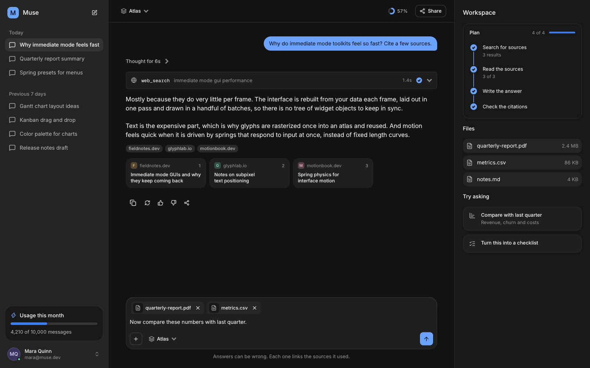

# Urania

Urania (the app calls itself Muse) is a desktop chat app for Claude, written in [Jolt](https://jolt-lang.net) (Clojure on Chez
Scheme) with [cui-jolt](https://github.com/jlt-commons/cui-jolt). Its layout follows CUI's
[`assistant.c`](https://yappologistic.github.io/CUI/#/app/assistant).



It starts [`claude-agent-acp`](https://www.npmjs.com/package/@agentclientprotocol/claude-agent-acp)
with `npx` and talks to it over the [Agent Client Protocol](https://agentclientprotocol.com)
(`src/acp.clj`). It has:

- several chats, with streamed markdown answers, reasoning, tool calls, the agent's plan,
  permission prompts, model choice, context use and cost
- subchats: pick parts of a reply and branch a new chat from them, leaving the original as it is
- image attachments, from the attach button or by dropping files on the window
- saved prompts above the message box, inserted with one click and edited in a dialog
- every chat saved as markdown in `~/Muse` and reopened on the next launch

## Running

You need Jolt, Node and a logged-in Claude Code. cui-jolt must sit next to this repo with
libcui built:

```sh
git clone https://github.com/fricze/urania && cd urania
git clone https://github.com/jlt-commons/cui-jolt ../cui-jolt
(cd ../cui-jolt && jolt native)
jolt start        # start Muse in the current directory
jolt start ~/code # or in another working directory
jolt test         # tests, no agent or display needed
```
